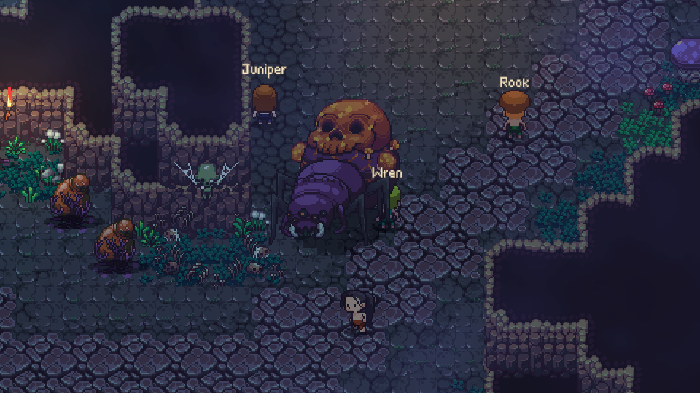
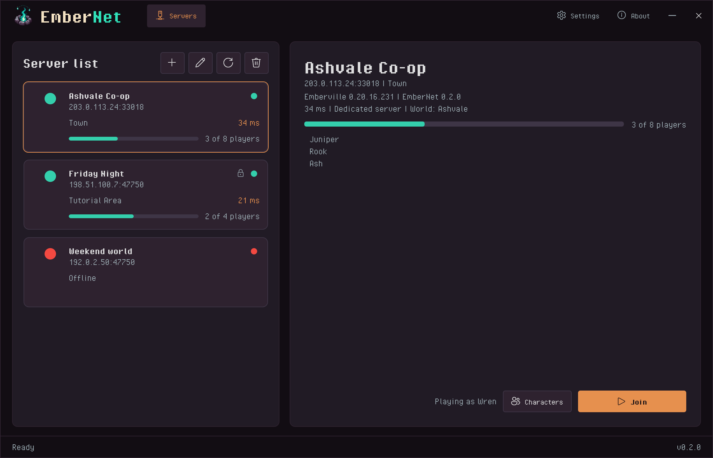
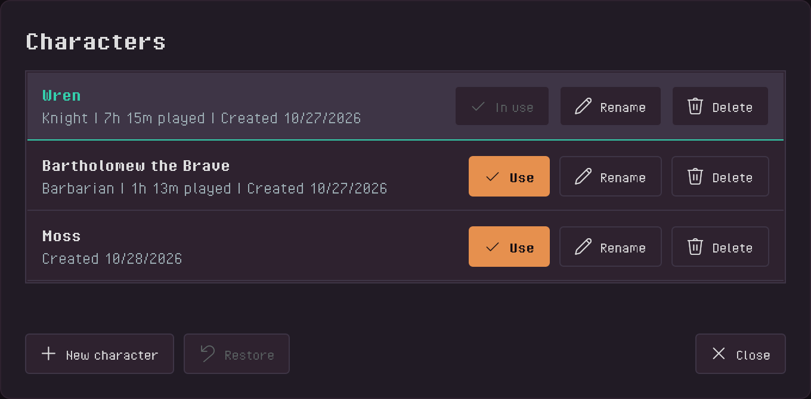
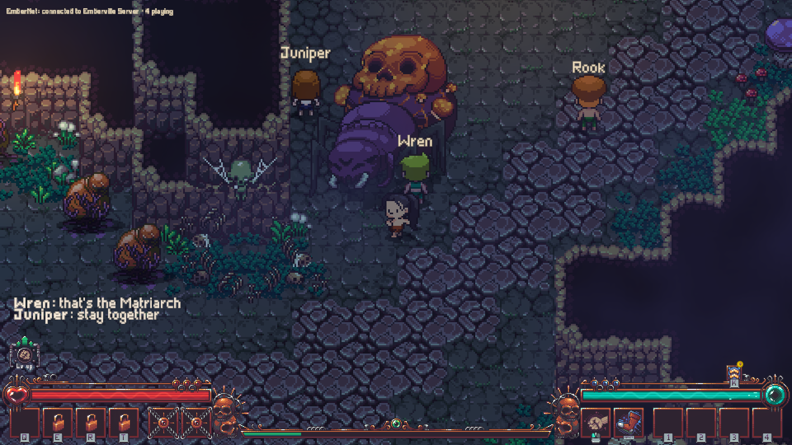
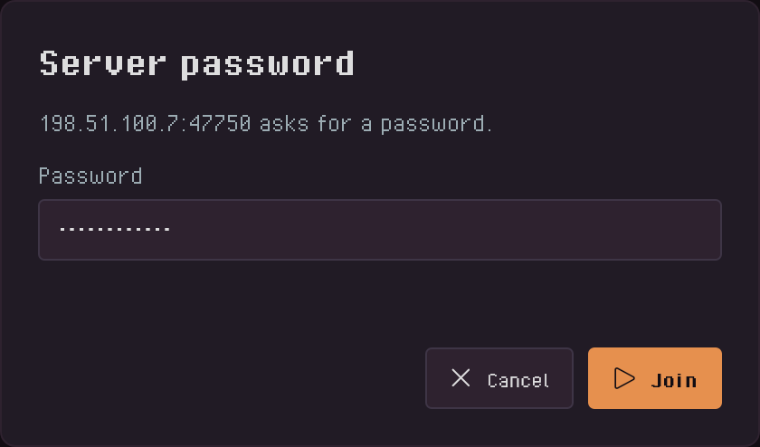
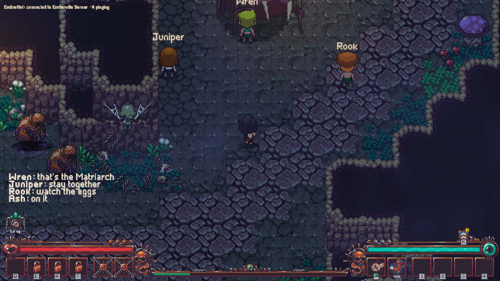

  

  
  
  
  
  

# EmberNet

Emberville has no multiplayer and no dedicated server. The game is single-player only, and its world exists on one player's PC. EmberNet adds Emberville online co-op through an Emberville dedicated server: [EmberNetServer](https://github.com/HumanGenome/EmberNetServer) runs the game headless on a Windows machine with a public IP and port, and the EmberNet app connects players to it by address.

Every player must install EmberNet to join an EmberNet server. Stock Emberville cannot connect to one.

## Features

### 🤝 Co-op in the same world
Everyone plays the same world: the same monsters, bosses, chests, doors, levers, quests and story. A monster one player hits is hurt for everyone, and a door one player opens is open for everyone. When the party leaves a map it travels together, and story scenes wait for every player.

  

### 🧭 Join by IP
Add the server's `ip:port` in the app and click Join. The app installs the mod, starts Emberville and joins with the character you picked. You can also type the address in the game's MULTIPLAYER menu. Before you join, the app shows whether the server is up, who is on it and which version it runs.

  

### 🎒 Bring your single-player character
Characters are Emberville's own saves on your PC, the same ones single-player uses. Bring one to a server or make a new one there. The app lists, renames, deletes and restores them. Keys and other quest items belong to the party: a key one player finds opens the door for everyone.

  

### 👥 Up to 16 players
A server takes 4 players unless its owner raises the limit. Everyone sees the other players with their own look and name.

  

### 🔒 Password protection
Set a password on the server and only players who know it can join.

  

### 💬 Text chat
Press **Enter** in game to chat with the party.

  

## Install

### Rent a server
[SurvivalServers.com Emberville server hosting](https://www.survivalservers.com/services/game_servers/emberville/?utm_source=github&utm_medium=readme_install&utm_campaign=embernet) comes with EmberNet installed and kept up to date, the port open, and a control panel.

### Players
1. Download `EmberNetSetup-latest.exe` from the [latest release](https://github.com/HumanGenome/EmberNet/releases/latest/download/EmberNetSetup-latest.exe).
2. Run it. One install per PC. The app updates itself from then on.
3. Open EmberNet, add the server address, pick a character, click Join.

### Self-hosted servers
Requirements, the settings file, ports and admin commands are in [EmberNetServer](https://github.com/HumanGenome/EmberNetServer). You need a Windows machine and Emberville's game files on it from your own Steam copy; the server package ships no part of the game.

## Releases

This repo publishes the player side: `EmberNetSetup-<version>.exe`, an `EmberNetSetup-latest.exe` alias, and the release notes. The server package is on the [EmberNetServer release page](https://github.com/HumanGenome/EmberNetServer/releases/latest), and the changelog for both sides is [EmberNetServer's CHANGELOG.md](https://github.com/HumanGenome/EmberNetServer/blob/main/CHANGELOG.md).

## Source

- **EmberNet** (this repo): the app players install, the downloads and the documentation.
- **[EmberNetServer](https://github.com/HumanGenome/EmberNetServer)**: the server package hosts run next to Emberville's game files.

## FAQ

### Does everyone need EmberNet?
Yes. Emberville has no multiplayer of its own, so every player in the party needs the mod. The app installs it once per PC.

### Does it change my game?
Single-player is unchanged. EmberNet adds `winhttp.dll` and a `BepInEx` folder next to `Emberville.exe`, and Steam keeps updating the game as normal. **Remove from Emberville** in the app's Settings takes them out (the loader stays only if another mod uses it).

### Where is my character saved?
On your PC, where Emberville keeps it. The server holds the world.

### What happens when Emberville updates?
Players and the server must run the same EmberNet version. After a game update the app updates itself and the mod, and says so if a server you saved runs a different version.

### Is this official?
No. EmberNet is an independent, fan-made project. It is not made by or affiliated with Cygnus Cross.
