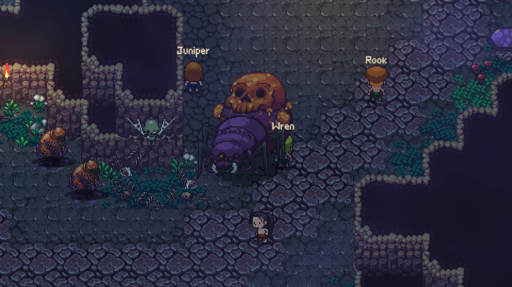
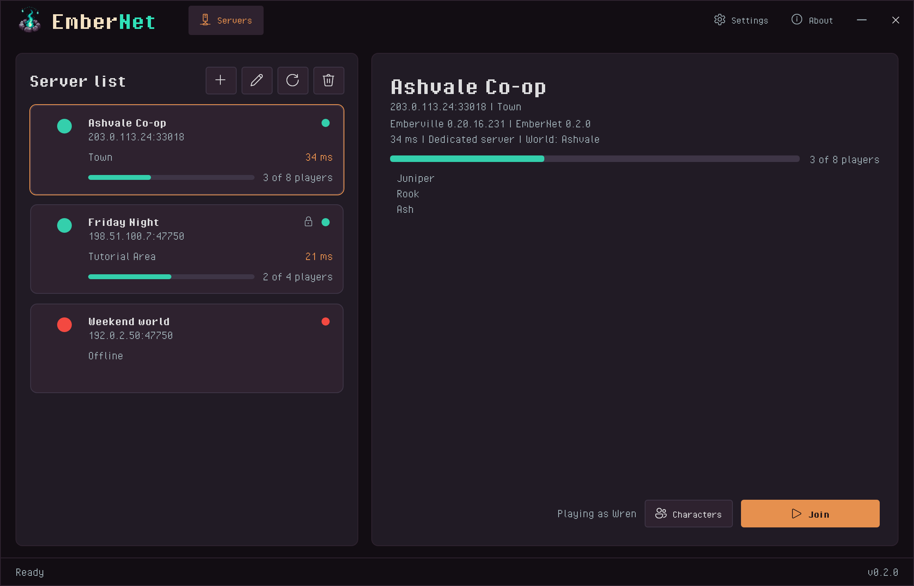
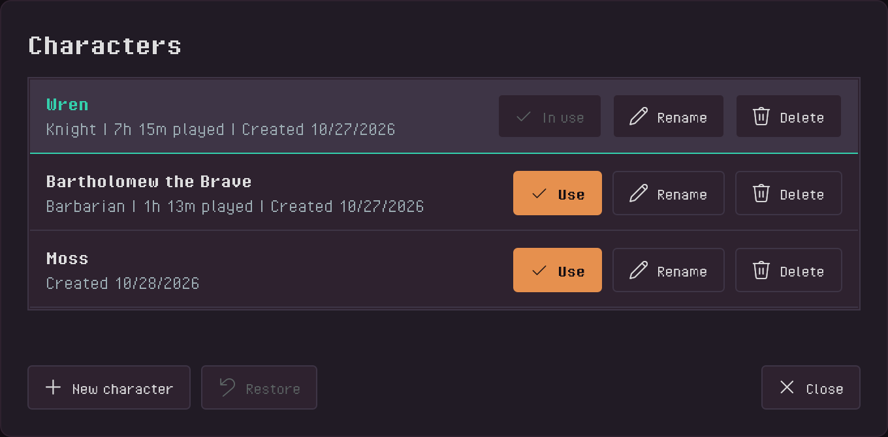
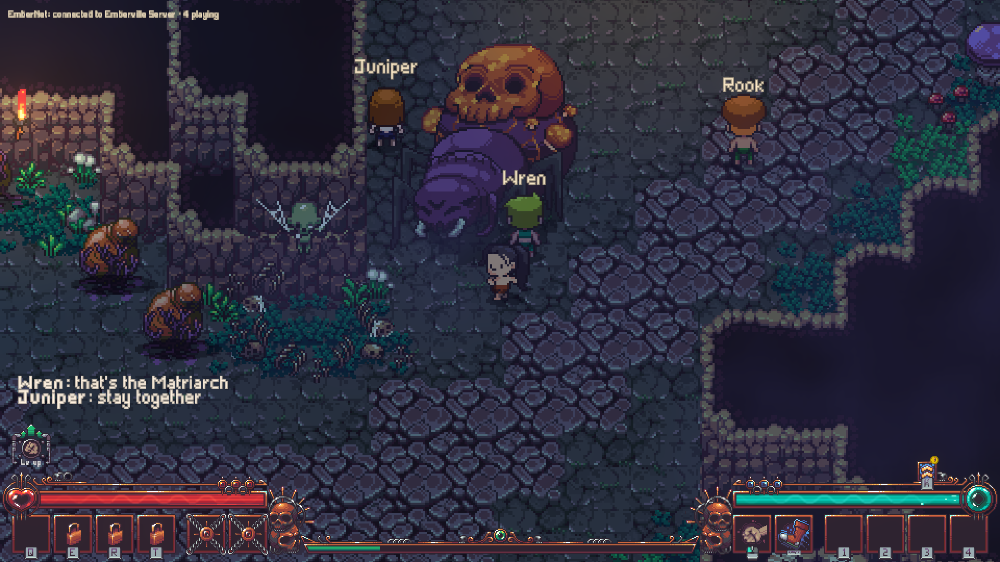
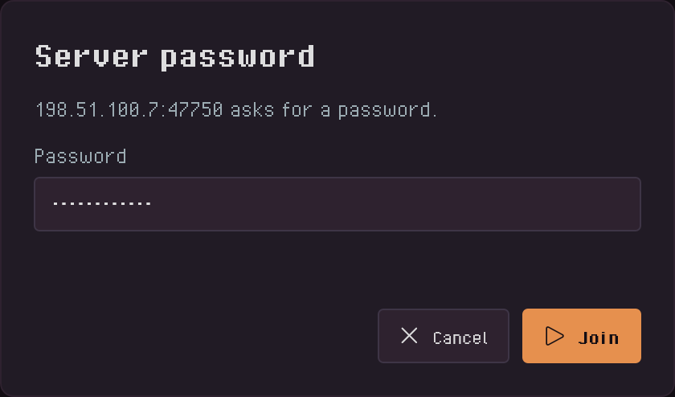
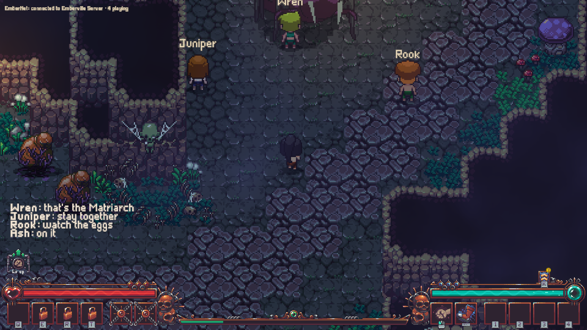

  

  
  
  
  
  

# EmberNet

Emberville has no multiplayer. EmberNet adds online co-op on an Emberville dedicated server, for up to 16 players.

Every player needs the EmberNet app to join.

## Features

### 🤝 Online co-op
Everyone plays the same world: the same monsters, bosses, chests, doors, levers, quests and story. A monster one player hits is hurt for everyone, and a door one player opens is open for everyone. When the party leaves a map it travels together, and story scenes wait for every player.

  

### 🧭 Join by IP
Add the server's `ip:port` in the app and click Join. The app installs the mod, starts Emberville and joins with the character you picked. You can also type the IP and port in the game's MULTIPLAYER menu. Before you join, the app shows whether the server is up, who is on it and which version it runs.

  

### 🎒 Bring your single-player character
Characters are Emberville's own saves on your PC, the same ones single-player uses. Bring one to a server or make a new one there. The app lists, renames, deletes and restores them. Keys and other quest items belong to the party: a key one player finds opens the door for everyone.

  

### 👥 Up to 16 players
A server takes 4 players until its owner raises the limit, up to 16. Everyone sees the other players with their own look and name.

  

### 🔒 Password protection
Set a password on the server and only players who know it can join.

  

### 💬 Text chat
Press **Enter** in game to chat with the party.

  

## Install

### Rent a server
[SurvivalServers.com](https://www.survivalservers.com/services/game_servers/emberville/?utm_source=github&utm_medium=readme_install&utm_campaign=embernet) runs Emberville servers with EmberNet installed.

### Players
1. Download `EmberNetSetup-latest.exe` from the [latest release](https://github.com/HumanGenome/EmberNet/releases/latest/download/EmberNetSetup-latest.exe).
2. Run it. If Windows shows "Windows protected your PC", click More info, then Run anyway. The app updates itself after that.
3. Open EmberNet, add the server's IP and port with +, pick a character and click Join.

### Host your own
You need a Windows PC and the Emberville game files from your own Steam copy. The setup steps are in [EmberNetServer](https://github.com/HumanGenome/EmberNetServer).

## Releases

Each release here has the app installer, `EmberNetSetup-<version>.exe`, and the same file as `EmberNetSetup-latest.exe`. The server download is on the [EmberNetServer releases page](https://github.com/HumanGenome/EmberNetServer/releases/latest). What changed in each version is in [CHANGELOG.md](https://github.com/HumanGenome/EmberNetServer/blob/main/CHANGELOG.md).

## FAQ

### Does it change my game?
Single-player is unchanged. EmberNet adds `winhttp.dll` and a `BepInEx` folder next to `Emberville.exe`, and Steam keeps updating the game as normal. **Remove from Emberville** in the app's Settings takes them out (the loader stays only if another mod uses it).

### Where is my character saved?
On your PC, where Emberville keeps it. The server holds the world.

### What happens when Emberville updates?
A game update can stop joins until a new EmberNet release is out. The app updates itself when it starts. Players and the server need the same network version. The app and the server say so when they differ.

### What if EmberNet closes to update and doesn't open again?
Download `EmberNetSetup-latest.exe` from the [latest release](https://github.com/HumanGenome/EmberNet/releases/latest) and run it once. Your saved servers and settings are kept. Versions before 0.2.3 couldn't update themselves when the Windows user folder's name had an accented letter, `!` or `%` in it.

---

EmberNet is a free, unofficial fan-made project. It's not made by or affiliated with Cygnus Cross.
